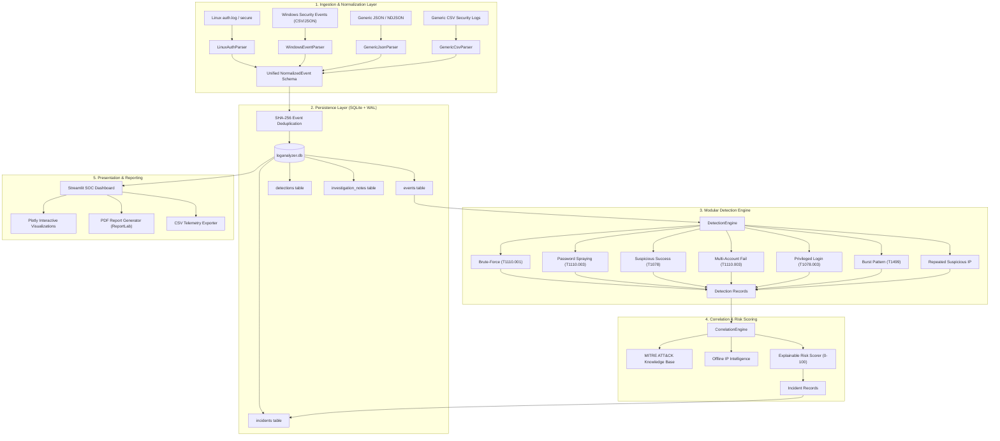
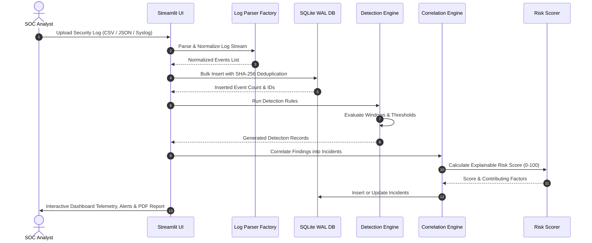

# LogAnalyzer Pro 🛡️

**Intelligent Security Log Analysis & Incident Investigation Platform**

[](https://www.python.org/)
[](LICENSE)
[](tests/)
[](https://streamlit.io/)
[](https://sqlite.org/)

---

## 1. Professional Introduction

**LogAnalyzer Pro** is an enterprise-grade, autonomous cybersecurity log analysis and incident investigation platform. Designed for Security Operations Center (SOC) teams, incident responders, and threat hunters, the application ingests heterogeneous security logs across Linux and Windows environments, normalizes disparate formats into a common schema, detects complex multi-stage attack patterns using modular behavioral rules, and synthesizes related detections into correlated, explainable security incidents.

Built strictly with free and open-source technologies, LogAnalyzer Pro delivers enterprise SIEM and SOAR investigation capabilities with zero reliance on paid APIs or external database services.

---

## 2. Problem Statement

Modern enterprise infrastructures generate gigabytes of disparate security logs daily:
- Linux server authentications (`auth.log` / `secure`)
- Windows Security Event Logs (`EventID 4624`, `4625`, `4672`, `4720`, `4740`)
- Cloud gateway, API, and VPN audit logs (JSON, NDJSON, and CSV)

SOC analysts routinely face critical bottlenecks:
1. **Format Fragmentation:** Incompatible timestamp standards, disparate field nomenclatures, and varying event structures prevent rapid analysis.
2. **Alert Fatigue:** Naive alerting generates hundreds of disconnected events rather than grouping findings into cohesive attack incidents.
3. **Misclassified Detections:** Generic tools often treat distributed password spraying attacks as individual single-account brute-force events, obscuring low-and-slow campaigns.
4. **Opaque Scoring:** Many commercial SIEMs produce black-box risk scores without explaining the specific technical factors behind the metric.

**LogAnalyzer Pro solves these challenges** by providing an end-to-end local SOC platform with normalized schemas, modular behavioral rules, deterministic correlation, explainable 0–100 risk scoring, and publication-ready PDF incident reporting.

---

## 3. Key Features

- **Multi-Source Ingestion & Normalization:** Ingests Linux authentication logs, Windows Security Event logs (CSV & JSON), generic NDJSON/JSON arrays, and arbitrary CSV logs into a unified `NormalizedEvent` schema with SHA-256 deduplication.
- **Advanced Behavioral Detection Engine:** 7 modular detection rules covering brute-force, distributed password spraying, credential compromise (success following repeated failures), multi-account failures, privileged account access, authentication burst velocity, and recurring IP threats.
- **Incident Correlation & Deduplication:** Clustered temporal correlation that links related alerts by source IP, targeted accounts, and attack windows into unified incident records, preventing duplicate tickets.
- **MITRE ATT&CK Enterprise Mapping:** All rules are mapped to official MITRE techniques (e.g. `T1110.001`, `T1110.003`, `T1078`, `T1078.003`, `T1499`) using an embedded local dataset.
- **Explainable 0–100 Risk Scoring:** Transparent scoring engine assessing baseline severity, account blast radius, failure velocity, credential compromise indicators, perimeter exposure, and multi-technique chaining.
- **Offline IP Intelligence:** RFC 1918 / loopback / public / reserved address profiling, account associations, and behavioral anomaly flagging without external network requests.
- **SOC Analyst Workbench:** Streamlit-powered dark-mode dashboard featuring Plotly timeline charts, failure trend distributions, interactive incident triage, and analyst case note logging.
- **Automated Reporting:** Generates professional, multi-page PDF security investigation reports via ReportLab and structured CSV telemetry exports for SIEM archival.

---

## 4. Architecture Diagram



---

## 5. End-to-End Data Flow



---

## 6. Technology Stack

- **Language:** Python 3.11+ / 3.12
- **Dashboard Interface:** Streamlit 1.30+
- **Database:** SQLite 3 (Write-Ahead Logging mode, indexed queries, parameterized statements)
- **Data Analytics:** Pandas, NumPy
- **Interactive Visualizations:** Plotly
- **Rule Configuration:** PyYAML
- **Report Generation:** ReportLab 4.0+
- **Automated Testing:** Pytest 8.0+

---

## 7. Detection Methodology

LogAnalyzer Pro features 7 detection rules configured via `loganalyzer/detection/rules_config.yaml`:

| Detection Rule | Threshold & Timing | MITRE Technique | Description |
| :--- | :--- | :--- | :--- |
| **`RULE_BRUTE_FORCE`** | $\ge 5$ failures in 10 mins | `T1110.001` | High-frequency attempts targeting a specific account or single IP. |
| **`RULE_PASSWORD_SPRAY`** | $\ge 3$ distinct accounts in 15 mins (low per-account failure cap) | `T1110.003` | Single source IP probing multiple accounts while evading single-account lockout. |
| **`RULE_SUSPICIOUS_SUCCESS`** | $\ge 3$ failures followed by success in 15 mins | `T1078` | Successful authentication immediately preceded by repeated failures (credential compromise). |
| **`RULE_MULTI_ACCOUNT_FAIL`** | $\ge 6$ failures across $\ge 4$ accounts in 20 mins | `T1110.003` | Broad account probing from a single perimeter IP. |
| **`RULE_SUSPICIOUS_LOGIN`** | Successful privileged authentication | `T1078.003` | Direct authentication to administrative identities (`root`, `Administrator`, `admin`, `system`). |
| **`RULE_UNUSUAL_PATTERNS`** | $\ge 12$ events in 60 secs | `T1499` | Transaction velocity anomaly indicative of automated credential stuffing or DoS. |
| **`RULE_REPEATED_SUSPICIOUS_IP`** | $\ge 2$ waves separated by $>15$ mins | `T1110.001` | Multi-stage recurring failure activity from the same IP. |

---

## 8. Risk-Scoring Methodology

Risk scores are normalized strictly between **0 and 100** and accompanied by an explicit breakdown of contributing risk factors:

$$\text{Risk Score} = \min\left(100, \text{Base Severity} + \text{Account Scope} + \text{Failure Volume} + \text{Compromise Indicator} + \text{Perimeter Exposure} + \text{Chained Techniques}\right)$$

### Scoring Weights:
- **Base Severity:** `CRITICAL` (+40), `HIGH` (+30), `MEDIUM` (+15), `LOW` (+5)
- **Account Blast Radius:** $>3$ distinct accounts (+20), $>1$ account (+10)
- **Failure Volume:** $\ge 10$ failures (+15), $\ge 5$ failures (+9)
- **Credential Compromise:** Success following repeated failures (+25)
- **Perimeter Origin:** Public IP origin (+10)
- **Attack Chaining:** Multi-technique correlation (+15)

---

## 9. MITRE ATT&CK Integration

Detections and correlated incidents are mapped to the MITRE ATT&CK Enterprise matrix:
- **T1110.001:** Brute Force: Password Guessing
- **T1110.003:** Brute Force: Password Spraying
- **T1078:** Valid Accounts
- **T1078.001:** Valid Accounts: Default Accounts
- **T1078.003:** Valid Accounts: Local Accounts
- **T1068:** Exploitation for Privilege Escalation
- **T1499:** Endpoint Denial of Service

---

## 10. Platform Screenshots

Actual genuine screenshots captured from the running LogAnalyzer Pro application:

| View | Screenshot |
| :--- | :--- |
| **SOC Overview Dashboard** |  |
| **Log Ingestion & Telemetry** |  |
| **Incident Investigation & Case Notes** |  |
| **Offline IP Intelligence & Profiling** |  |
| **MITRE ATT&CK Technique Matrix** |  |
| **Reports & Telemetry Data Exports** |  |
| **Generated PDF Security Report** |  |

---

## 11. Installation & Setup (Windows 11)

### Prerequisites
- Python 3.11 or 3.12 installed (`python --version`).
- Git (optional, for cloning).

### Step-by-Step Installation

1. **Clone or Navigate to the Repository:**
   ```powershell
   cd "C:\Users\aadit\OneDrive\Desktop\LOGANALYZER PRO"
   ```

2. **Create a Virtual Environment (Recommended):**
   ```powershell
   python -m venv venv
   .\venv\Scripts\Activate.ps1
   ```

3. **Install Dependencies:**
   ```powershell
   pip install -r requirements.txt
   ```

---

## 12. Execution Instructions

Launch the Streamlit SOC interface:
```powershell
streamlit run app.py
```
The interface will automatically open in your default browser at `http://localhost:8501`.

---

## 13. Demonstration Scenarios

LogAnalyzer Pro provides ready-to-run synthetic attack datasets in `data/demo_scenarios/`:
- **Scenario A (Brute Force):** Single IP targeting `root` with 7 consecutive failures.
- **Scenario B (Password Spraying):** Single IP targeting 6 distinct identities with 1 attempt each.
- **Scenario C (Credential Compromise):** 4 failures followed immediately by a successful login.
- **Scenario D (Normal Traffic):** Legitimate corporate SSH authentications generating zero false-positive alerts.

To generate or reset all demo datasets programmatically:
```powershell
python -m loganalyzer.synthetic_generator --reset-db
```
For a comprehensive step-by-step SOC walk-through, see the [SOC Demonstration Guide](docs/SOC_DEMO_GUIDE.md).

---

## 14. Automated Testing

LogAnalyzer Pro features a 33-test Pytest suite covering all parsers, detection rules, boundary thresholds, correlation clustering, risk scoring, SQLite queries, and report generation.

Run the test suite:
```powershell
python -m pytest -v
```

Execution Summary:
```
============================= test session starts =============================
platform win32 -- Python 3.12.4, pytest-9.2.0, pluggy-1.7.0
rootdir: C:\Users\aadit\OneDrive\Desktop\LOGANALYZER PRO
configfile: pytest.ini
testpaths: tests
collected 33 items

tests/test_correlation.py::test_correlation_groups_by_ip_and_avoids_duplicates PASSED
tests/test_database.py::test_event_insertion_and_deduplication PASSED
tests/test_database.py::test_detection_persistence PASSED
tests/test_database.py::test_incident_lifecycle PASSED
tests/test_database.py::test_ingestion_history_and_stats_summary PASSED
tests/test_detection_rules.py::test_brute_force_rule_triggers PASSED
tests/test_detection_rules.py::test_password_spraying_rule_triggers PASSED
tests/test_detection_rules.py::test_suspicious_success_rule_triggers PASSED
tests/test_detection_rules.py::test_multi_account_fail_rule_triggers PASSED
tests/test_detection_rules.py::test_suspicious_login_rule_triggers PASSED
tests/test_detection_rules.py::test_unusual_patterns_burst_rule PASSED
tests/test_detection_rules.py::test_repeated_suspicious_ip_rule PASSED
tests/test_detection_rules.py::test_brute_force_boundary_below_threshold PASSED
tests/test_detection_rules.py::test_brute_force_events_outside_time_window PASSED
tests/test_detection_rules.py::test_password_spraying_vs_brute_force_separation PASSED
tests/test_detection_rules.py::test_suspicious_success_with_intervening_success PASSED
tests/test_detection_rules.py::test_detection_rules_empty_dataset PASSED
tests/test_detection_rules.py::test_detection_rules_malformed_events PASSED
tests/test_detection_rules.py::test_different_source_ips_isolation PASSED
tests/test_mitre_mapping.py::test_mitre_dataset_loading PASSED
tests/test_mitre_mapping.py::test_mitre_rule_mappings PASSED
tests/test_mitre_mapping.py::test_technique_validation PASSED
tests/test_parsers.py::test_linux_auth_parser_valid PASSED
tests/test_parsers.py::test_linux_auth_parser_invalid_lines PASSED
tests/test_parsers.py::test_windows_events_parser_csv PASSED
tests/test_parsers.py::test_windows_events_parser_json PASSED
tests/test_parsers.py::test_generic_json_parser PASSED
tests/test_parsers.py::test_generic_csv_parser PASSED
tests/test_parsers.py::test_parser_factory_auto_detection PASSED
tests/test_reporting.py::test_pdf_report_generation PASSED
tests/test_reporting.py::test_csv_exports PASSED
tests/test_risk_scoring.py::test_risk_score_normalization_and_factors PASSED
tests/test_risk_scoring.py::test_severity_threshold_mappings PASSED

======================== 33 passed in 1.43s ========================
```

---

## 15. Project Structure

```
LOGANALYZER PRO/
├── app.py                          # Streamlit SOC Application Entry Point
├── requirements.txt                # Production dependencies
├── LICENSE                         # MIT License
├── CONTRIBUTING.md                 # Contribution guidelines
├── pytest.ini                      # Pytest configuration
├── README.md                       # Comprehensive platform documentation
│
├── assets/                         # Visual assets & screenshots
│   └── screenshots/                # Application UI screenshots
│
├── docs/                           # Technical documentation
│   ├── ARCHITECTURE.md             # System architecture and data flow
│   ├── DETECTION_RULES.md          # Detection engine rule specifications
│   ├── TESTING.md                  # Test execution and validation guide
│   ├── FINAL_AUDIT.md              # Quality and security audit report
│   └── SOC_DEMO_GUIDE.md           # Step-by-step analyst demo walk-through
│
├── data/                           # Labeled synthetic test security logs
│   ├── linux_auth.log              # Linux SSH brute-force & spray logs
│   ├── windows_events.csv          # Windows Event Log CSV (4624/4625/4672/4740)
│   ├── windows_events.json         # Windows Event Log JSON (Remote compromise)
│   ├── generic_security.json       # Generic JSON API credential stuffing
│   ├── generic_security.csv        # Generic CSV VPN MFA failure log
│   └── demo_scenarios/             # Dedicated Scenarios A, B, C, D
│
├── loganalyzer/                    # Core application package
│   ├── __init__.py
│   ├── config.py                   # Paths, defaults, and risk weights
│   ├── schema.py                   # Normalized event schema & data models
│   ├── database.py                 # SQLite WAL manager and CRUD methods
│   ├── synthetic_generator.py      # Synthetic test log generator
│   │
│   ├── parsers/                    # Ingestion parsers
│   │   ├── __init__.py
│   │   ├── base.py                 # Base parser & timestamp normalizer
│   │   ├── linux_auth.py           # Linux auth.log / secure parser
│   │   ├── windows_events.py       # Windows Security CSV/JSON parser
│   │   ├── generic_json.py         # Generic NDJSON / JSON parser
│   │   ├── generic_csv.py          # Generic CSV log parser
│   │   └── factory.py              # File signature parser factory
│   │
│   ├── detection/                  # Detection Engine
│   │   ├── __init__.py
│   │   ├── base.py                 # Base rule class
│   │   ├── engine.py               # Rule evaluation orchestrator
│   │   ├── rules_config.yaml       # Configurable thresholds & windows
│   │   └── rules/                  # Modular behavioral rules
│   │       ├── brute_force.py
│   │       ├── password_spraying.py
│   │       ├── suspicious_success.py
│   │       ├── multi_account_fail.py
│   │       ├── suspicious_login.py
│   │       ├── unusual_patterns.py
│   │       └── repeated_suspicious_ip.py
│   │
│   ├── correlation/                # Event Correlation
│   │   ├── __init__.py
│   │   └── correlator.py           # Incident grouping & deduplication
│   │
│   ├── intel/                      # Intelligence & Mapping
│   │   ├── __init__.py
│   │   ├── ip_intelligence.py      # Offline RFC IP profiling & indicators
│   │   ├── mitre_mapper.py         # MITRE ATT&CK technique mapper
│   │   ├── risk_scorer.py          # Explainable 0-100 risk scorer
│   │   └── mitre_data.json         # Embedded MITRE technique database
│   │
│   └── reporting/                  # Reporting & Exports
│       ├── __init__.py
│       ├── pdf_report.py           # ReportLab PDF security report builder
│       └── csv_export.py           # CSV telemetry exporters
│
├── ui/                             # Streamlit SOC User Interface
│   ├── __init__.py
│   ├── components.py               # SOC CSS dark theme & metric widgets
│   └── views/                      # Navigation pages
│       ├── overview.py             # SOC Overview & Plotly analytics
│       ├── ingestion.py            # Upload, validation & synthetic data
│       ├── incidents.py            # Incident management & case notes
│       ├── ip_intel.py             # Deep IP investigation tool
│       ├── mitre_view.py           # MITRE ATT&CK matrix explorer
│       └── reports_view.py         # PDF & CSV report generation
│
└── tests/                          # Automated Pytest suite
    ├── conftest.py                 # Fixtures & temporary databases
    ├── test_parsers.py             # Parser tests
    ├── test_detection_rules.py     # All detection & boundary rule tests
    ├── test_correlation.py         # Correlation & incident tests
    ├── test_risk_scoring.py        # Risk scoring tests
    ├── test_mitre_mapping.py       # MITRE mapping tests
    ├── test_database.py            # SQLite persistence tests
    └── test_reporting.py           # PDF and CSV report tests
```

---

## 16. Limitations

- **Offline Operating Mode:** External threat intelligence (e.g. VirusTotal, AbuseIPDB, MaxMind GeoIP) is not queried by default to guarantee 100% offline functionality and zero paid API requirements.
- **Log Source Scope:** Optimized for authentication and identity security logs; deep packet inspection (PCAP) and kernel syscall tracing (eBPF) are out of scope.
- **Single-Node Architecture:** Designed for local SOC analyst workstations; distributed streaming (e.g. Apache Kafka/Elasticsearch cluster) is not included.

---

## 17. Future Enhancements

- Integrate offline MaxMind GeoLite2 MMDB for local country and city resolution without network calls.
- Implement Sigma rule translation to convert community detection signatures directly into LogAnalyzer Pro rules.
- Add Sysmon Windows Event ID coverage (Process creation `1`, Network connection `3`, DNS `22`).
- Provide automated webhook notifications (Discord, Slack, or Microsoft Teams) on `CRITICAL` incidents.

---

## 18. Security Disclaimer

This platform and its synthetic test logs are created strictly for defensive security engineering, SOC operations, and incident response research purposes. All sample logs and indicators in the `data/` directory are synthetic and do not represent real individuals, organizations, or live security incidents.

---

## 19. Author and Contribution Information

- **Author:** LogAnalyzer Pro Team
- **License:** [MIT License](LICENSE)
- **Contributions:** Contributions are welcomed! Please read [CONTRIBUTING.md](CONTRIBUTING.md) for pull request workflows and testing instructions.
