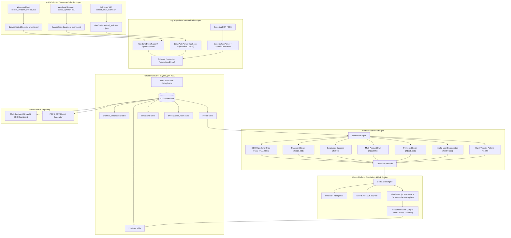

# LogAnalyzer Pro — System Architecture (Phase 3: Multi-Endpoint)

## Overview

**LogAnalyzer Pro** is an intelligent, high-performance endpoint security log analysis and incident investigation platform designed for SOC analysts, incident responders, and threat hunters.

It employs a decoupled, multi-endpoint pipeline:
1. **Multi-Source Telemetry Ingestion & Normalization:** Ingests heterogeneous security logs from both **Windows** (native Security Event XML, Sysmon, Application) and **Linux** (Kali Linux `auth.log`, systemd `journalctl` text and NDJSON), as well as generic JSON/CSV, normalizing them into a unified schema (`NormalizedEvent`).
2. **Incremental Collection & State Checkpointing:** High-water mark state tracking in SQLite (`channel_checkpoints`) and JSON checkpoints (`data/checkpoints/`) enables reliable incremental ingestion.
3. **Persistence Engine:** Efficient SQLite persistence with Write-Ahead Logging (WAL), deterministic SHA-256 event hashing for 100% duplicate prevention, and indexed parameterized queries.
4. **Detection Engine:** Modular, configurable rule evaluation against the normalized event stream, linking each alert to MITRE ATT&CK Enterprise techniques (T1110, T1078, T1087, T1499).
5. **Cross-Platform Correlation Engine:** Clusters detections across source IPs, usernames, endpoints, and temporal windows into holistic security incidents, flagging cross-platform lateral movement between Linux and Windows hosts.
6. **Security Intelligence & Risk Scoring:** Computes transparent, explainable 0–100 risk scores based on attack scope, severity, and host behavioral indicators.
7. **Multi-Endpoint SOC Dashboard & Reporting:** Streamlit frontend with Plotly analytics, endpoint and platform filtering, and automated PDF report generation via ReportLab.

---

## Architectural Flowchart

---

## Data Model Specifications

- **`NormalizedEvent`**: Unified data class for Linux and Windows telemetry:
  - `timestamp`: UTC datetime (ISO 8601)
  - `source_type`: `linux_auth`, `windows_events`, `sysmon`, `generic_json`, `generic_csv`
  - `event_type`: `authentication`, `privilege`, `system`, `network`, `process`
  - `action`: `LOGIN`, `FAILED_LOGIN`, `SUDO`, `OTHER`
  - `status`: `SUCCESS`, `FAILURE`, `UNKNOWN`
  - `username`, `source_ip` (IPv4 & IPv6), `destination_ip`, `port`
  - `hostname`, `process_id`, `process_name`, `command_line`
  - `channel`, `record_id`, `is_synthetic`
  - `raw_log`: original verbatim record for forensic verification
  - `event_hash`: deterministic SHA-256 hash
