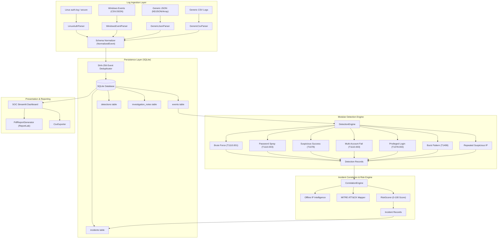

# LogAnalyzer Pro — System Architecture

## Overview

**LogAnalyzer Pro** is an intelligent, high-performance security log analysis and incident investigation platform designed for SOC analysts, incident responders, and threat hunters.

It employs a decoupled, modular pipeline:
1. **Ingestion & Normalization:** Ingests heterogeneous security logs (Linux Syslog, Windows Security Events, generic JSON/CSV) and normalizes them into a unified schema (`NormalizedEvent`).
2. **Persistence Engine:** Efficient SQLite persistence with Write-Ahead Logging (WAL), deterministic SHA-256 event hashing for deduplication, and indexed queries.
3. **Detection Engine:** Modular, configurable rule evaluation against the normalized event stream, linking each alert to MITRE ATT&CK Enterprise techniques.
4. **Correlation Engine:** Clusters detections across source IPs, usernames, and temporal windows into holistic security incidents, avoiding duplicate incident tickets.
5. **Security Intelligence & Risk Scoring:** Computes transparent, explainable 0–100 risk scores based on attack scope, severity, and host behavioral indicators.
6. **SOC Dashboard & Reporting:** Streamlit frontend with Plotly analytics and automated PDF report generation via ReportLab.

---

## Architectural Flowchart

---

## Core Data Schema

### `NormalizedEvent`
- `event_id`: Auto-incrementing database ID.
- `timestamp`: UTC datetime.
- `source_type`: `linux_auth`, `windows_events`, `generic_json`, `generic_csv`.
- `event_type`: `authentication`, `privilege`, `account_management`, `system`.
- `action`: `LOGIN`, `FAILED_LOGIN`, `SUDO`, `USER_CREATED`, `ACCOUNT_LOCKED`, `OTHER`.
- `status`: `SUCCESS`, `FAILURE`, `UNKNOWN`.
- `username`: Target or subject account name.
- `source_ip`: Source IPv4/IPv6 address.
- `port`: Connection port.
- `service`: Daemon or service name (`sshd`, `sudo`, `Security`, etc.).
- `message`: Human-readable summary.
- `raw_log`: Verbatim log line.
- `metadata`: JSON payload containing context-specific attributes (PID, LogonType, etc.).
- `event_hash`: SHA-256 hash `(timestamp, source_type, user, IP, action, status, raw_log)`.
